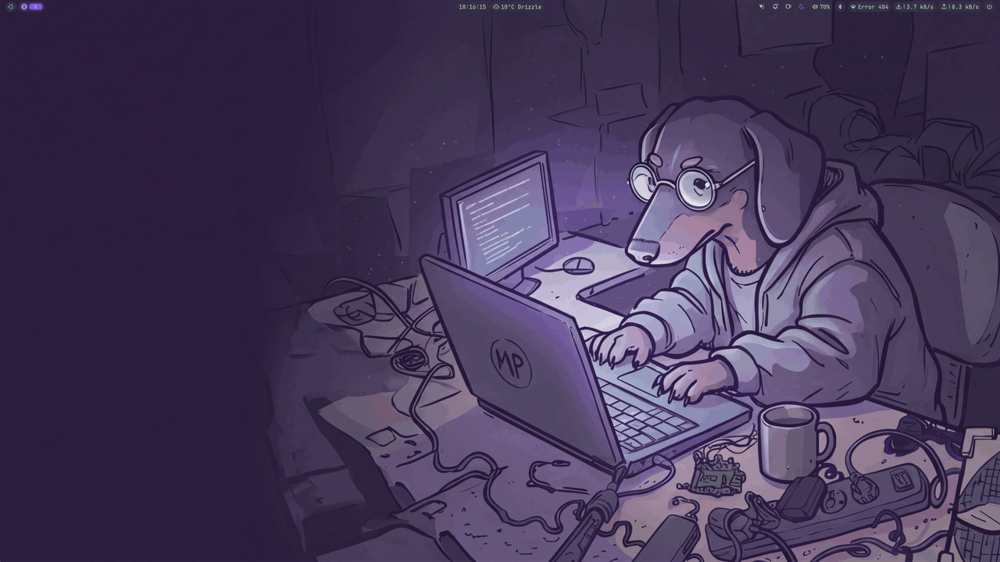
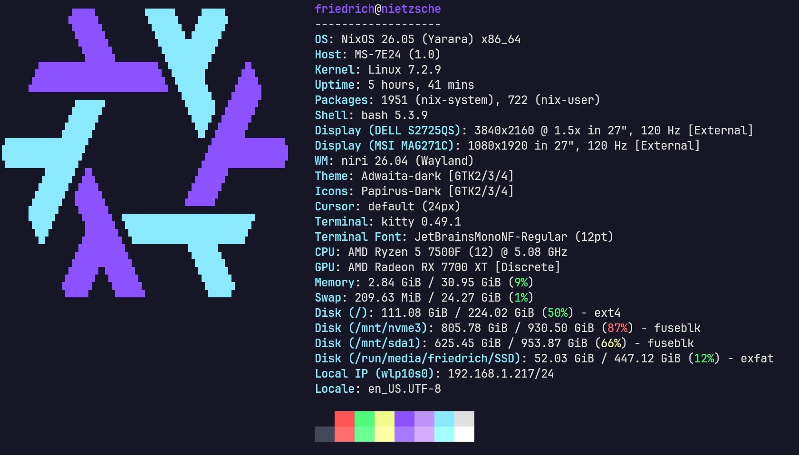
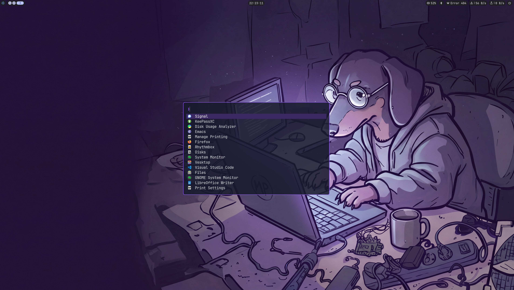

<div align="center">

# nix-os-configuration

**A NixOS flake for two machines with a Niri Wayland desktop, the Noctalia shell, one color file and plain dotfiles.**

No Home Manager · one palette for every app · every config checked at build time



</div>

## Highlights

- **Scrolling tiling with Niri**: windows open in columns that you scroll through, with
  Noctalia providing the bar, launcher, notifications, clipboard history, screenshots, lock
  screen and login greeter.
- **One color scheme**: `modules/theme/colors.nix` is the only file that contains colors.
  kitty, Niri, Neovim, Zellij, GTK 2/3/4, Qt 5/6, Noctalia and the greeter all use it, and
  `make check` fails if a hex color appears anywhere else.
- **Plain dotfiles**: `dotfiles/` mirrors `$HOME` and NixOS links every file into place.
  There is no Home Manager.
- **Configs validated at build time**: a broken Niri or Noctalia config fails the build, so
  you never log in to a broken desktop.
- **Dendritic layout**: every `.nix` file under `modules/` is a flake-parts module that is
  imported automatically. To add a feature, create a file.
- **Development tools from Nix**: LazyVim with all its language servers, .NET 8/9/10,
  Rust, Go, Python, Docker, JetBrains IDEs and Zed.

| Host | Machine | User | Profile |
|------|---------|------|---------|
| `nietzsche` (main) | Desktop: Ryzen 5 7500F, RX 7700 XT | `friedrich` | `workstation` |
| `dostoyevsky` | Dell Latitude 5531: i7-12800H, Iris Xe + GeForce MX550, 32 GB, 2 × 512 GB | `fiodor` | `laptop` |

<table>
  <tr>
    <td></td>
    <td></td>
  </tr>
  <tr>
    <td align="center">kitty with the navy and purple palette</td>
    <td align="center">Launcher (<code>Mod+Space</code> / <code>Mod+R</code>); this screenshot predates Noctalia's launcher</td>
  </tr>
</table>

## Quick start

The system builds from `/etc/nixos`. The `Makefile` copies this repo there and runs
`nixos-rebuild` for `HOST`, which defaults to the machine's hostname.

```sh
nix develop      # make, git, rsync, nixfmt, wf-recorder, ffmpeg; prints the targets
make check       # build both hosts, validate dotfiles, check formatting
make switch      # copy to /etc/nixos, activate and set as the boot default
```

> [!WARNING]
> `make install` (run by `switch`, `test` and `boot`) uses rsync `--delete`, so anything in
> `/etc/nixos` that isn't in the repo is removed.

## Everyday commands

### Updating

Run `nixupdate` inside the repo, or anywhere if `NIXOS_REPO` is set. It updates
`flake.lock`, copies the repo to `/etc/nixos` and switches. `nh` then lists which package
versions changed.

```sh
nixupdate                                  # update every input
nixupdate noctalia-shell nixpkgs-unstable  # update only these
nixupdate --help                           # list the inputs
```

`make update` and `make update-input INPUT=<name>` only change `flake.lock`, without
switching.

### Shell aliases

| Command | Does |
|---------|------|
| `nixswitch` / `nixtest` / `nixboot` | Rebuild from `/etc/nixos` with `nh` (switch, activate without a boot entry, set the boot default) |
| `nixupdate [input...]` | Update the flake, install and switch |
| `nixclean` / `nixgc` | Delete old generations (keeps 7 days and at least 3) / all old generations |
| `nixopt` | Deduplicate the store |
| `nsearch` / `nshell` / `nrun` | `nix search nixpkgs` / `nix-shell -p` / `nix run` |
| `zj` | `zellij` |
| `nixhelp` | List every alias |

### Make targets

```sh
make help                      # all targets
make build [HOST=dostoyevsky]  # build without touching the system (./result)
make diff                      # preview what install would change in /etc/nixos
make test                      # install and activate, no boot entry
make boot                      # install, use on next reboot
make rollback                  # back to the previous generation
make gc                        # delete generations older than 14 days
nix fmt                        # format all .nix files
```

## Stack

| Input | Purpose |
|-------|---------|
| `nixpkgs` (nixos-26.05) | Base system and Niri (`programs.niri`) |
| `nixpkgs-unstable` | Newer apps, available as `pkgs.unstable` |
| `flake-parts` | Module system for the flake itself |
| `rust-overlay` | Rust toolchain with `rust-src` |
| `noctalia-shell` | Bar, launcher, notifications, clipboard, screenshots, wallpaper, lock screen, idle, polkit |
| `noctalia-greeter` | greetd login screen styled like Noctalia (replaces GDM) |

## Layout

Each file adds one feature to a named NixOS module, `flake.nixosModules.<feature>`, and
each host lists the features it uses. Files starting with `_` are not auto-imported.

```
flake.nix                    # Inputs; imports every file in modules/
modules/
  parts.nix                  # Systems, formatter, devShell, checks
  theme/
    colors.nix               #   THE color scheme: the only file with colors in it
    options.nix              #   Types and docs for every color role (validated)
    apply.nix                #   Writes each app's color file, Qt palette, GSettings
  base/                      # nixosModules.base, every host:
    user.nix                 #   my.user option; creates the user
    nixpkgs.nix              #   allowUnfree; pkgs.unstable overlay (+ rust-overlay)
    dotfiles.nix             #   Links dotfiles/common + dotfiles/<host> into $HOME
    boot.nix, nix.nix        #   systemd-boot, kernel, firmware, Mesa, zram; Nix daemon
    locale.nix, services.nix #   Time zone, keyboard, fonts; network, SSH, Avahi, printing
    cli.nix                  #   nh, starship, aliases, nixhelp, nixupdate
  features/                  # One nixosModules.<name> each:
    desktop.nix              #   greeter, PipeWire, polkit, gvfs; imports theme, niri,
                             #   noctalia, kitty, nautilus
    niri.nix, noctalia.nix   #   compositor; shell (+ udiskie), both validated at build time
    kitty.nix, nautilus.nix  #   terminal; file manager and its actions
    neovim.nix, apps.nix     #   LazyVim; everyday apps and terminal tools
    development.nix          #   Docker, Git, IDEs, Zellij, toolchains, nixd/nil/nixfmt
    dotnet.nix               #   .NET SDKs 10/9/8, C# language servers, nix-ld libs
    ai.nix, creative.nix
    workstation.nix          #   performance governor, scx_lavd, Bluetooth on
    laptop.nix               #   upower, power-profiles-daemon, lid handling
  hosts/<name>/
    configuration.nix        #   nixosConfigurations.<name>: features + hardware
    _hardware-configuration.nix
dotfiles/common/             # Shared dotfiles, laid out like $HOME
dotfiles/<host>/             # Per-host overrides (niri host.kdl, noctalia host.toml)
patches/                     # Patches for Noctalia and its udiskie plugin
scripts/                     # Helpers behind the Nautilus actions
static-files/                # Wallpaper and README screenshots
```

## Colors

`modules/theme/colors.nix` holds the semantic roles (`background`, `surface`, `primary`,
`selection`, …), the 16 terminal colors, the light/dark `mode`, the GNOME accent preset and
the Papirus folder color. Edit it and rebuild. `modules/theme/apply.nix` generates a color
file for each app, and the app's own dotfile includes it:

| App | Generated file | Included from |
|-----|----------------|---------------|
| kitty | `~/.config/kitty/theme.conf` | `kitty.conf` (`include`) |
| Niri | `~/.config/niri/theme.kdl` | `config.kdl` (`include`) |
| Neovim | `~/.config/nvim/lua/theme.lua` | `init.lua` (`require("theme")`) |
| Zellij | `~/.config/zellij/themes/system.kdl` | `config.kdl` (`theme "system"`) |
| GTK 3/4 | `~/.config/gtk-{3,4}.0/colors.css`, `settings.ini` | `gtk.css` (`@import`) |
| GTK 2 | `~/.gtkrc-2.0` | (whole file) |
| Qt 5/6 | `/etc/xdg/qt5ct/colors/theme.conf`, `qt{5,6}ct.conf` | (whole file) |
| Noctalia | `palettes/<name>.json`, `theme.toml` | merged after `config.toml` |
| Login greeter | greeter settings | `services.displayManager.noctalia-greeter` |

Every color must be a `#rrggbb` value and every role must be set, so a typo fails
evaluation. Starship uses named ANSI colors and follows the terminal palette. Theme changes
saved from Noctalia's settings window are removed each time the shell starts, so the palette
from `colors.nix` always applies.

## Dotfiles

Every file under `dotfiles/common/` and `dotfiles/<hostname>/` is linked to the same path in
your home directory. For example, `dotfiles/common/.config/kitty/kitty.conf` becomes
`~/.config/kitty/kitty.conf`. If a host file has the same path as a common one, the host file
wins.

- **Read-only links**: files are copied into the Nix store and linked with systemd-tmpfiles
  at boot and on every switch. Edit the repo, not the files in your home directory. This
  includes Zellij's `config.kdl`, which its built-in settings screen can no longer save.
- **Only files are linked**, never whole directories, so apps can keep their own state next
  to them.
- **A link replaces whatever is at its path.** If you delete a dotfile from the repo, its
  link is left behind; remove it by hand.
- **Host overrides use includes**: Niri's `config.kdl` includes `host.kdl`, and Noctalia
  merges every `*.toml` in name order, so `host.toml` overrides `config.toml`. TOML arrays
  replace the shared ones instead of merging with them, so the laptop's bar repeats the whole
  widget list.
- **No store paths or home directories** appear in dotfiles: the wallpaper is at
  `/etc/backgrounds/wallpaper.png`.
- **Generated files**: modules can add files with `dotfiles.files."<path>" = <file>;`
  (see `modules/theme/apply.nix`). These replace files at the same path in the tree.

<details>
<summary>Migrating from Home Manager</summary>

The first switch replaces Home Manager's links for files that also exist here. Remove the
rest once, then log out and back in:

```sh
find ~ -xdev -lname '/nix/store/*-home-manager-files/*' -print -delete
rm -rf ~/.local/state/home-manager ~/.local/state/nix/profiles/home-manager*
systemctl --user daemon-reload
```

</details>

## Desktop

| Keys | Action |
|------|--------|
| `Mod+Return` / `Mod+Q` | kitty |
| `Mod+Space` / `Mod+R` | Launcher (or start typing in the overview, `Mod+O`) |
| `Mod+S` / `Mod+N` | Control center / Noctalia settings |
| `Alt+Tab` | Window switcher |
| `Ctrl+Grave` | Clipboard history |
| `Print` / `Shift+Print` / `Mod+Print` | Screenshot of a region / the screen / with annotations |
| `Mod+Shift+Print` | Screenshot of a window (Niri) |
| `Mod+Shift+R` | Screen recording (gpu-screen-recorder) |
| `Mod+L` / `Mod+Escape` | Lock |

The screen locks after 10 minutes idle and turns off a minute later. Weather, night light
(18:00–06:00) and the calendar use `[location]`; add calendar accounts in Settings →
Calendar. GTK and Qt apps use purple accents and violet Papirus folders. After a theme
change, restart apps, and log out and back in for the Qt platform setting.

## Editor

Neovim runs [LazyVim](https://lazyvim.org) and is the default editor, including for text
files opened from Nautilus. Nix provides every plugin, Tree-sitter grammar, language server,
formatter and debugger; lazy.nvim never downloads anything and Mason is turned off. The
config is in `dotfiles/common/.config/nvim`. Press `F1` (or run `:Cheatsheet`) for the keys.

| Languages | Language servers |
|-----------|------------------|
| C# · Go · Python · Rust · C/C++ | Roslyn · gopls · Pyright + Ruff · rust-analyzer · clangd |
| TypeScript/JS · JSON/HTML/CSS · Markdown | vtsls · vscode-langservers · Marksman |
| Nix · Lua · Bash · YAML · TOML · Docker | nixd · lua-language-server · bash-language-server · yaml-language-server · Taplo · dockerfile/compose |

Debugging uses netcoredbg, Delve and debugpy, and tests run through neotest.

<details>
<summary>.NET (Rider and Zed)</summary>

`modules/features/dotnet.nix` installs one `dotnet` with the .NET 10, 9 and 8 SDKs (10 is
the default; pin another version with `global.json`), plus `dotnet-ef`, CSharpier,
netcoredbg, the OmniSharp, csharp-ls and Roslyn language servers, and Mono.

- `DOTNET_ROOT` and `/etc/dotnet/install_location` point at the SDK. Log out and back in
  after the first switch.
- `dotnet tool install --global` works, and `~/.dotnet/tools` is on `PATH`.
- Prebuilt native binaries (global tools, `Grpc.Tools`' protoc, Avalonia/SkiaSharp) run
  through nix-ld with ICU, OpenSSL, Kerberos and the X11/font libraries.
- inotify limits are raised for `dotnet watch`, hot reload and IDE file watchers.
- .NET 8 and 9 leave support in November 2026. Once nixpkgs marks them insecure, they are
  dropped with a build warning instead of breaking the build.
- `dotnet workload install` can't write to the read-only SDK. MAUI and wasm workloads need a
  writable SDK, for example one installed with `dotnet-install.sh`.

**Rider** finds `dotnet` on `PATH` automatically. For HTTPS during development, run
`dotnet dev-certs https` once; browsers need the certificate imported by hand.

**Zed**: install the C# extension. It finds OmniSharp and csharp-ls on `PATH`. To use Roslyn
instead, add this to `~/.config/zed/settings.json`:

```json
{
  "languages": { "CSharp": { "language_servers": ["roslyn", "!omnisharp", "!csharp-ls"] } },
  "lsp": {
    "roslyn": {
      "binary": {
        "path": "/run/current-system/sw/bin/Microsoft.CodeAnalysis.LanguageServer",
        "arguments": ["--stdio", "--autoLoadProjects"]
      }
    }
  }
}
```

</details>

<details>
<summary>Nix language server (Zed and Rider)</summary>

nixd completes NixOS options (from `nietzsche`), flake-parts options and nixpkgs attributes.
It reads the installed flake at `/etc/nixos`, so run `make install` once. The flake sets
`debug = true` for this, which causes the "unknown flake output 'debug'" warning.

- **Zed**: `.zed/settings.json` configures nixd and nixfmt; install the Nix extension when
  Zed offers it.
- **Rider**: install *NixIDEA* and *LSP4IJ*, then add a language server with the command
  `nixd`, the file pattern `*.nix`, and the `lsp.nixd.settings` object from
  `.zed/settings.json` as its configuration.

</details>

## Hosts

### dostoyevsky (laptop)

- The Intel GPU drives the screen. The MX550 stays powered off until you start an app with
  `nvidia-offload <command>`. The laptop uses the LTS kernel so the NVIDIA driver always
  builds.
- The bar adds brightness, power profile and battery. Bluetooth starts off. Closing the lid
  suspends, unless an external monitor is connected.
- Only one NVMe drive is in use. To use the second one, format it and add a `fileSystems`
  entry.
- Before the first switch, check the GPU bus IDs with `lspci -D | grep -Ei 'vga|3d'`. If
  they differ from `PCI:0:2:0` (Intel) and `PCI:1:0:0` (NVIDIA), update
  `hardware.nvidia.prime`.

### nietzsche (desktop)

- The Dell S2725QS runs at 3840×2160, 120 Hz and 1.5× scale. The MSI MAG271C runs at
  1920×1080, 120 Hz and 1× scale, rotated 90° (the bar is hidden on it). VRR is off.
- Notifications, OSDs and panels opened from the bar appear only on `HDMI-A-1`.
- The `performance` governor and `scx_lavd` (sched_ext) are on. The MT7921 Wi-Fi runs with
  PCIe ASPM and power saving off. Nix builds run at idle CPU and I/O priority, so rebuilds
  don't stall the desktop.

<details>
<summary>Troubleshooting display flicker (nietzsche)</summary>

Niri keeps a frame-completion workaround and restricts direct scanout to matching buffer
formats. These are mitigations for intermittent white lines, not a confirmed hardware fix.
This Niri release has no HDR output; keep HDR off in the Dell menu.

If flashes persist, try turning off the wallpaper (`enabled = false` under `[wallpaper]` in
`dotfiles/common/.config/noctalia/config.toml`), then check the logs:

```sh
journalctl --user -b -u niri --no-pager -g 'ERROR|WARN'
journalctl -b -k --no-pager -g 'amdgpu|drm|timeout'
```

Earlier diagnostics recorded AMD display-buffer timeouts, MSI HDMI hotplug events and GLES
texture upload errors. Unexpected hotplugs point to the cable, the port or the monitor's
power settings, which no configuration can fix.

</details>

<details>
<summary>Boot performance</summary>

The measured baseline was 30.1 s to boot: 11.2 s firmware, 5.5 s loader and 8.4 s
userspace. Recent changes haven't been benchmarked yet. Compare after a reboot with
`systemd-analyze`, `systemd-analyze --user blame`, `systemctl --failed` and
`systemctl --user --failed`. Keep network readiness enabled, because Ollama model downloads
and firmware refresh depend on it. Hold Space during boot to choose an older generation.

</details>

## Remote access

Connect with `ssh friedrich@nietzsche`. Root login is disabled. To reach a service on
nietzsche's `localhost:3000` from another computer:

```sh
ssh -N -o ExitOnForwardFailure=yes -L 127.0.0.1:3000:127.0.0.1:3000 friedrich@nietzsche
```

Then open `http://127.0.0.1:3000` on that computer.

## Adding a machine

1. Create `modules/hosts/<name>/` with `_hardware-configuration.nix` from
   `nixos-generate-config` (keep the `_` prefix), and a `configuration.nix` that defines
   `flake.nixosConfigurations.<name>`. Import `base`, `desktop`, either `workstation` or
   `laptop`, and any other features you want. Set `networking.hostName`, `my.user`, the
   user's `description` and `system.stateVersion`. Copying an existing host is the easiest
   start.
2. Create `dotfiles/<name>/.config/niri/host.kdl` (required, may be empty) and, if needed,
   `dotfiles/<name>/.config/noctalia/host.toml`.

`make check` builds every host automatically.

<details>
<summary>Recording a README GIF</summary>

Inside `nix develop` (stop recording with Ctrl+C):

```sh
wf-recorder -o HDMI-A-1 -r 30 -f /tmp/rec.mp4
ffmpeg -i /tmp/rec.mp4 -vf "fps=12,scale=1280:-1:flags=lanczos,split[a][b];[a]palettegen=stats_mode=diff[p];[b][p]paletteuse=dither=bayer:bayer_scale=5:diff_mode=rectangle" static-files/desktop-showcase.gif
```

</details>
